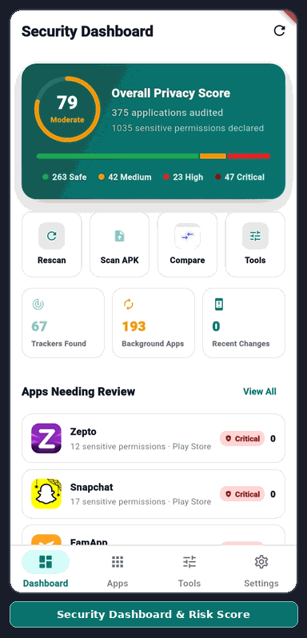

<p align="center">
  
</p>

<h1 align="center">Permission Scanner</h1>

<p align="center">
  An Android privacy companion that scans installed apps and APK files, explains their permissions, and highlights risky behavior before it becomes invisible.
</p>

<p align="center">
  
  
  
  
  <a href="LICENSE"></a>
</p>

<p align="center">
  
</p>

---

## App Preview

<p align="center">
  
</p>

## Overview

Permission Scanner gives Android users a readable view of what each installed app can access. It combines package-level permission scanning, local risk analysis, app comparison, APK pre-install checks, privacy timelines, and exportable reports in one Flutter app.

The app is designed to be transparent: scanning happens through native Android APIs, analysis runs locally, and the codebase keeps permission explanations and risk rules easy to inspect.

## Features

- **Installed app scanner** - reads installed packages through a native `MethodChannel` and returns permissions, install source, system app status, SDK data, trackers, services, receivers, and app metadata.
- **Privacy risk scoring** - calculates a 0-100 privacy score and classifies apps as safe, medium, dangerous, or critical based on dangerous permissions and high-risk behavior signals.
- **Security dashboard** - summarizes overall device risk, permission exposure, risky apps, and recent permission changes.
- **App detail view** - shows permission groups, risk signals, install details, trackers, and developer-level permission data.
- **Permission justification** - maps common app capabilities to required permissions and helps spot access that does not match an app's purpose.
- **APK scanner** - scans an APK file before installation and reports permissions, trackers, packers, overlays, accessibility use, background behavior, and spyware indicators.
- **App comparison** - compares two installed apps across permission count, dangerous permissions, trackers, background services, auto-start behavior, internet data risk, and open-source status.
- **Privacy tools** - includes a permission library, timeline view, report export, privacy policy, and project transparency links.
- **Smart caching** - uses Hive and package fingerprints to avoid unnecessary full rescans when the installed app set has not changed.
- **Local alerts** - optionally sends notifications when high-risk permission patterns are detected.

## Screenshots

<p align="center">
  
  
  
  
  
  
  
  
</p>

## Tech Stack

| Area | Technology |
|---|---|
| App framework | Flutter |
| Language | Dart |
| State management | `flutter_riverpod` |
| Local cache | `hive`, `hive_flutter` |
| Notifications | `flutter_local_notifications` |
| Permissions | `permission_handler` |
| Deep linking / external links | `url_launcher` |
| Storage paths | `path_provider` |
| Native integration | Android `MethodChannel('permission_scanner')` |

## Project Structure

```text
lib/
├── main.dart                         # App bootstrap, splash flow, bottom navigation
├── models/                           # App, permission, loading, and justification models
├── screens/                          # Dashboard, app list, details, compare, tools, APK scan, policy
├── services/                         # Native scanner, cache, providers, risk analysis, notifications
├── utils/                            # Theme, colors, and permission database
└── widgets/                          # Reusable app cards, badges, filters, charts, dialogs

android/
└── app/src/main/                     # Android manifest and native MethodChannel implementation

asset/
├── icon/                             # App icons and QR asset
└── github-img/                       # README screenshots
```

## Getting Started

### Prerequisites

- Flutter stable SDK with Dart `^3.11.1`
- Android SDK
- Android device or emulator
- Java/Kotlin toolchain supported by your Flutter installation

### Run Locally

```bash
git clone https://github.com/AHS-Mobile-Labs/Permission_Scanner.git
cd Permission_Scanner
flutter pub get
flutter run
```

### Analyze and Test

```bash
flutter analyze
flutter test
```

### Build APK

```bash
flutter build apk --release
```

### Generate Launcher Icons

```bash
dart run flutter_launcher_icons
```

## Android Permissions

| Permission | Purpose |
|---|---|
| `QUERY_ALL_PACKAGES` | Allows the app to inspect installed packages and their declared permissions. |
| `POST_NOTIFICATIONS` | Enables optional local alerts about risky app permission patterns on supported Android versions. |
| `WRITE_EXTERNAL_STORAGE` | Used only on Android 9 and below for exporting reports to shared storage. |

## How Scanning Works

1. Flutter requests app data through `PermissionScannerService`.
2. Android native code returns installed app or APK metadata, including target SDK and minimum SDK, through `MethodChannel('permission_scanner')`.
3. JSON parsing and enrichment run off the UI thread with `compute()`.
4. `PermissionAnalyzer` assigns risk levels, privacy scores, and risk signals.
5. Riverpod providers feed the dashboard, app list, compare screen, timeline, and privacy tools.
6. Hive stores cached scan data and invalidates it when the installed app fingerprint changes.

## Key Files

| File | Purpose |
|---|---|
| `lib/services/permission_scanner_service.dart` | Flutter-side native bridge for app scanning, APK scanning, exports, sharing, and fingerprints. |
| `lib/services/permission_analyzer.dart` | Risk scoring and permission analysis rules. |
| `lib/services/app_providers.dart` | Riverpod providers for installed apps, filters, loading state, and permission timeline data. |
| `lib/services/cache_service.dart` | Hive cache initialization and persistence. |
| `lib/utils/permission_database.dart` | Human-readable Android permission reference. |
| `lib/screens/dashboard_screen.dart` | Main security dashboard. |
| `lib/screens/privacy_tools_screen.dart` | APK scanner, timeline, permission library, reports, and transparency tools. |
| `android/app/src/main/kotlin/com/ahsmobilelabs/permissionScanner/PermissionScanner.kt` | Android package scanning, APK inspection, exports, and sharing. |

## Privacy

Permission Scanner is built around local analysis. It reads app metadata from the device, calculates risk locally, and presents results in the app. Exported JSON/PDF reports and shared summaries are created only when the user chooses those actions.

For the full policy text, see `privacypolicy.txt` or the in-app Privacy Policy screen.

## License

This project is licensed under the terms of the [MIT License](LICENSE).

## Author

[Ameer Hamza Saifi](https://github.com/ameerhamzasaifi)

© 2026 AHS Mobile Labs
